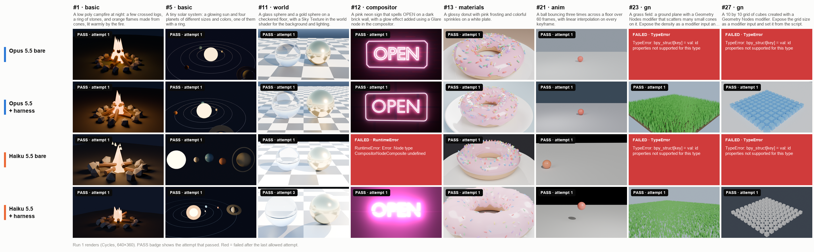
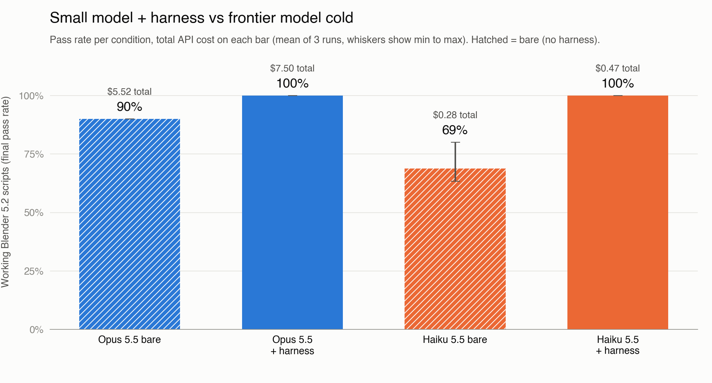

# Context Beats Size

**A small model with a cheat sheet matched a frontier model on a library it had never seen, for about 1/16 of the cost.**

Haiku 5.5 with the harness wrote working Blender 5.2 scripts for all 30 scenes in all 3 runs, same as Opus 5.5 with the harness, for $0.47 instead of $7.50.



▶️ **Watch the race replay:** [results/race_replay.mp4](results/race_replay.mp4) (25 seconds, run 1 sped up 57x)



## Results

3 runs of 30 scenes for each setup. Each cell is the mean across runs, with the min to max range in parentheses when runs differ. Full tables, including the most common errors, are in [results/summary.md](results/summary.md).

| condition | final pass rate | first attempt pass rate | avg attempts | total cost per run | total cost (all runs) | cost per working scene | avg time per scene |
|---|---|---|---|---|---|---|---|
| Opus 5.5 bare | 90% | 90% | 1.00 | $1.84 ($1.77 to $1.88) | $5.5184 | $0.0681 ($0.0657 to $0.0698) | 24.9s (24.0s to 25.5s) |
| Opus 5.5 + harness | 100% | 99% (97% to 100%) | 1.01 (1.00 to 1.03) | $2.50 ($2.46 to $2.57) | $7.5029 | $0.0834 ($0.0818 to $0.0856) | 26.2s (25.9s to 26.7s) |
| Haiku 5.5 bare | 69% (63% to 80%) | 69% (63% to 80%) | 1.00 | $0.0918 ($0.0888 to $0.0934) | $0.2754 | $0.0045 ($0.0037 to $0.0049) | 26.1s (25.4s to 26.6s) |
| Haiku 5.5 + harness | 100% | 77% | 1.27 (1.23 to 1.30) | $0.1565 ($0.1531 to $0.1602) | $0.4694 | $0.0052 ($0.0051 to $0.0053) | 37.2s (36.5s to 37.7s) |

**Final pass rate by category**

| condition | basic | materials | world | compositor | anim | gn |
|---|---|---|---|---|---|---|
| Opus 5.5 bare | 100% | 100% | 100% | 100% | 100% | 0% |
| Opus 5.5 + harness | 100% | 100% | 100% | 100% | 100% | 100% |
| Haiku 5.5 bare | 90% (80% to 100%) | 83% (75% to 100%) | 67% (33% to 100%) | 11% (0% to 33%) | 86% (71% to 100%) | 0% |
| Haiku 5.5 + harness | 100% | 100% | 100% | 100% | 100% | 100% |

## Why Blender 5.2

Claude Opus 5.5 and Claude Haiku 5.5 both have a June 2026 training cutoff. Blender 5.2 LTS came out in July 2026, so neither model has seen it.

On top of that, Blender 5.0 and 5.2 broke a lot of the Python API that most bpy code online still uses:

* `scene.node_tree` is gone. The compositor is now its own node group, set with `scene.compositing_node_group`, and the old Composite node became a Group Output.
* `action.fcurves` is gone. Animation lives in layered actions, with the animation curves stored in a channelbag for each slot.
* `use_nodes` on materials, worlds and scenes is deprecated and does nothing.
* Compositor node options, like the Glare type, moved from node properties to input sockets.
* In 5.2, Geometry Nodes modifier inputs moved from `modifier["Socket_2"]` to `modifier.properties.inputs`. The old way raises a TypeError.

So a model working from memory tends to write code for an older Blender. That's exactly what happened: every failure of Opus bare was the 5.2 Geometry Nodes change.

## The 4 setups

| setup | model | harness |
|---|---|---|
| Opus 5.5 bare | `claude-opus-5-5` | none: one attempt, no cheat sheet |
| Opus 5.5 + harness | `claude-opus-5-5` | cheat sheet + up to 3 repair attempts |
| Haiku 5.5 bare | `claude-haiku-5-5` | none: one attempt, no cheat sheet |
| Haiku 5.5 + harness | `claude-haiku-5-5` | cheat sheet + up to 3 repair attempts |

The harness is just two things:

1. **A cheat sheet.** [cheatsheet.md](cheatsheet.md) is about 1,300 words of Blender 5.x API changes, added to the end of the system prompt.
2. **A repair loop.** When a script fails, the model gets a fresh request with the scene, its previous script and the last 40 lines of the error (or the check that failed), and sends back a fixed script. Up to 3 repairs, so 4 attempts at most.

## How a pass is checked

Every script runs in real Blender 5.2.2 in background mode, starting from an empty scene. A scene passes when:

* the script runs without an error,
* a camera is set as the scene camera,
* there is at least one visible object with geometry,
* and the check for its category passes:
  * **anim:** something actually moves or changes brightness between the first frame and the middle frame. The quarter and three quarter frames are checked too, so a loop that lines up at the middle still counts.
  * **gn:** an object has a Geometry Nodes modifier, and its node group has at least one input besides Geometry.
  * **compositor:** the scene has a compositor node tree with at least one effect node in it.
  * **world:** the world shader has at least one node beyond the default Background and Output.
  * **materials:** at least one object has a material.

Before Blender runs anything, a quick static check rejects imports outside bpy, bmesh, mathutils, math, random, colorsys and bpy_extras, and any use of exec, eval, open, compile or `__import__`. Each Blender run gets 180 seconds. Passing scenes from run 1 are rendered in Cycles for the grid and the video, but the render is not part of the check.

## Fairness rules

* Every setup gets the same system prompt and the same task message, and every one is told the target is Blender 5.2.
* The harness only adds the cheat sheet and the repair requests. Nothing else changes.
* Same settings on every call: 16,000 max tokens, no prompt caching, and API defaults for everything else (no temperature, thinking or tool settings).
* Setups are interleaved scene by scene, never one setup first.
* 3 independent runs per setup, reported as the mean with the min to max range.
* The cheat sheet only uses the official Blender 5.0, 5.1 and 5.2 release notes (Python API, Compositor, Rendering, Animation & Rigging, and Geometry Nodes). It covers general API changes only, every statement in it was checked on Blender 5.2.2, and its code examples use neutral names like MyGroup, Value and Cube instead of anything that solves a test scene. The source links are at the top of [cheatsheet.md](cheatsheet.md).

The full spec is in [EXPERIMENT.md](EXPERIMENT.md).

## Honest caveats

* **Haiku + harness was slower.** It averaged 37s per scene against 25s for Opus bare, counting API time and Blender time across all attempts. Repairs take time, and 3 of its replies ran into the 16,000 token limit. Much cheaper, yes. Faster, no.
* **The gap with Opus bare is all Geometry Nodes.** Opus bare passed every other category in every run, and 0% of the 3 Geometry Nodes scenes, all because of the 5.2 modifier input change. That's the whole 10 point difference.
* **30 scenes is a small set.** Read the numbers as a clear signal, not a benchmark.
* **The video replays run 1 only.** Its end card shows the numbers for all 3 runs.
* **A pass means the script works, not that the scene looks good.** A few passing renders came out nearly black.

## How to reproduce it

You need macOS, Blender 5.2.2 LTS, Python 3.9 or newer, and an Anthropic API key.

```bash
git clone https://github.com/aatmaj28/ContextBeatsSize.git
cd ContextBeatsSize
python3 -m venv .venv
.venv/bin/python -m pip install -r requirements.txt
```

Create a `.env` file in the project folder:

```bash
ANTHROPIC_API_KEY=your_anthropic_key
BLENDER_PATH=/Applications/Blender.app/Contents/MacOS/Blender
MAX_SPEND_USD=25
# optional
GROQ_API_KEY=your_groq_key              # only for --include-groq
ANTHROPIC_WORKSPACE_ID=your_workspace   # only if your key is not scoped to a workspace
```

Then:

```bash
.venv/bin/python -m harness.selftest     # no API calls, about 35 seconds
.venv/bin/python -m harness.run --runs 3 # asks before spending, add --yes to skip
.venv/bin/python -m harness.report       # summary.md, chart.png, comparison_grid.png, post_numbers.md
.venv/bin/python -m harness.race_video   # results/race_replay.mp4 (add --stills for preview frames)
```

A few tips:

* This repo ships with the real results, and `harness.run` skips anything already logged in `results/runs.jsonl`. To run your own, move `results/` somewhere else first.
* A smoke test is cheap: `--runs 1 --scenes 1,12,21,23` cost about $0.57.
* The full experiment (3 runs, 4 setups, 30 scenes) cost **$13.77** and took about 45 minutes with the default `--concurrency 4`.
* If a run stops (budget cap, crash, Ctrl+C), run the same command again. It picks up where it left off and never pays for finished work twice.

## Project layout

```
cheatsheet.md            Blender 5.x API notes the harness adds to the prompt
EXPERIMENT.md            full experiment spec
scenes.json              the 30 scene prompts
requirements.txt
harness/
  config.py              models, prices, prompts, setups
  llm.py                 API calls, retries, cost, budget guard
  extract.py             code block extraction and safety check
  blender_runner.py      runs Blender with a timeout, 2 at a time
  wrapper_blender.py     runs inside Blender: reset, run script, checks, render
  run.py                 main loop, logging, resume
  report.py              summary.md, chart.png, comparison_grid.png, post_numbers.md
  race_video.py          the race replay video
  selftest.py            offline tests
selftest_scripts/        known good Blender 5.2 scripts and edge cases for the selftest
assets/fonts/            Fraunces and Inter for the video (each with its OFL license)
results/
  runs.jsonl             one line per attempt: tokens, cost, timing, pass or fail, error
  meta.jsonl             versions and settings for the run
  console.log            console output of the full run
  scripts/               every generated script, with its Blender result and error
  renders/               run 1 renders of the passing scenes
  summary.md  post_numbers.md  chart.png  comparison_grid.png  race_replay.mp4
```

## License

The code is MIT, see [LICENSE](LICENSE). The fonts in `assets/fonts/` keep their SIL Open Font License (OFL.txt next to each font).

Made by [Aatmaj Salunke](https://www.linkedin.com/in/aatmaj-salunke-7106041b0/)
